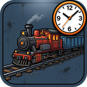

# Train ETA — Factorio 2.0 mod

Find out **how long a train takes to get from A to B and how much fuel it burns** — before you build the route.

Open the map, pick a fuel, tick the train types you care about, click two rails or train stops, and read the result.

## Features

- Lists every train type currently on rails, grouped by composition (e.g. `1× Locomotive + 4× Cargo wagon`).
- Fuel selector with item icons — every fuel your locomotives accept, including modded ones.
- Shortest route found by the game's own train pathfinder, drawn on the map along the rails while the panel is open.
- Estimated travel time and fuel burned, simulated from train physics: acceleration, braking, air resistance, fuel acceleration/top-speed bonuses and your braking-force research.
- Selected train types and fuel are remembered between games (hidden per-player mod settings).
- English and Russian locales.

## Usage

1. Press the **Train ETA** shortcut button (or `Ctrl+Shift+Y`). The panel works on top of the map view.
2. Choose a fuel and tick one or more train types.
3. Press **Pick points** and click two rails or two train stops on the map.
4. The panel shows the path length, the estimated time and the fuel burned for every ticked train type.

## Limitations

- The weight used is the **empty** train; cargo makes real trips slower.
- Signals, other trains and station queues are not simulated, so real trips can take longer.
- Train direction is taken from where the locomotives point, not from the route.
- This is a first release; feedback comparing estimates with real trips is very welcome.

## Install

- From the in-game mod portal / [mods.factorio.com](https://mods.factorio.com) (search for **Train ETA**), or
- Download `train-eta_0.2.0.zip` from the [Releases](../../releases) page and put it into your `mods` folder (`%APPDATA%\Factorio\mods` on Windows). Do not unzip it.

Requires Factorio 2.0.

## Development

The repository root is the mod itself. To test locally, copy the folder into `mods/` as `train-eta_0.2.0`.

## License

[MIT](LICENSE)
